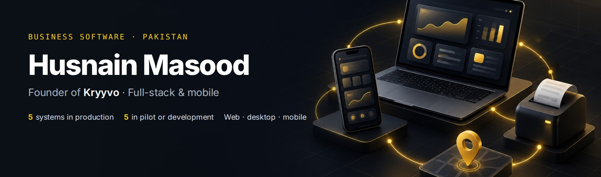
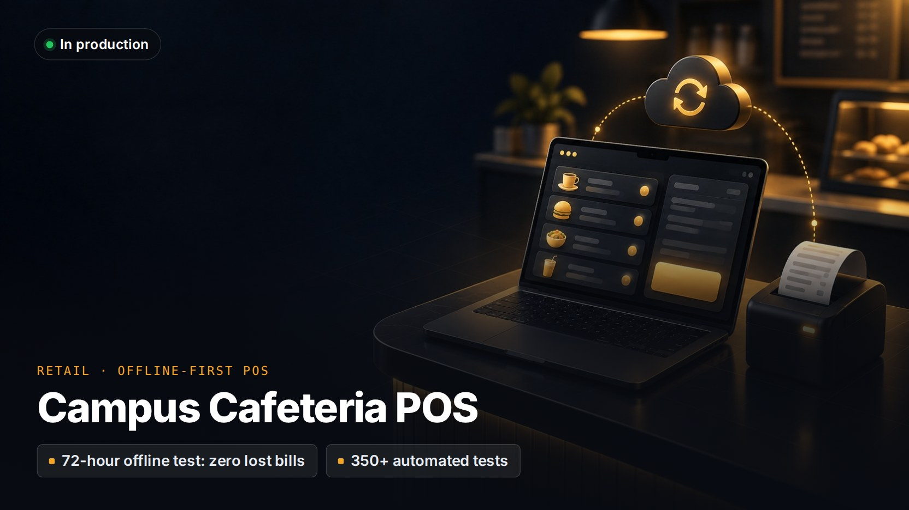
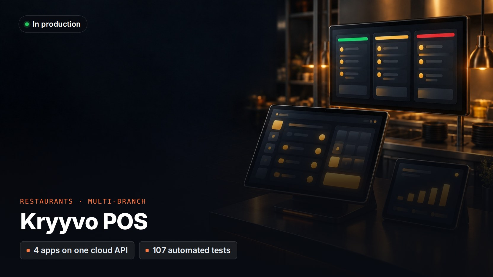
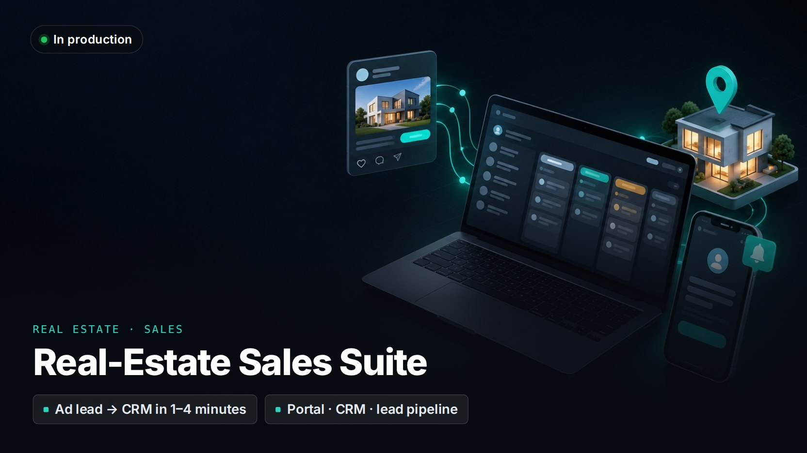
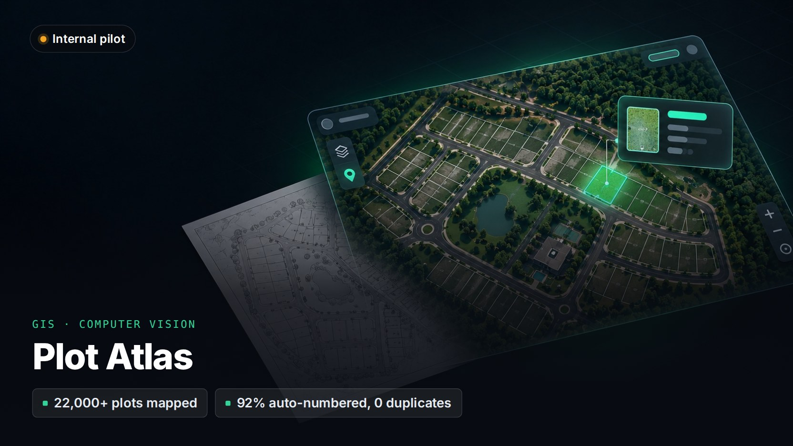
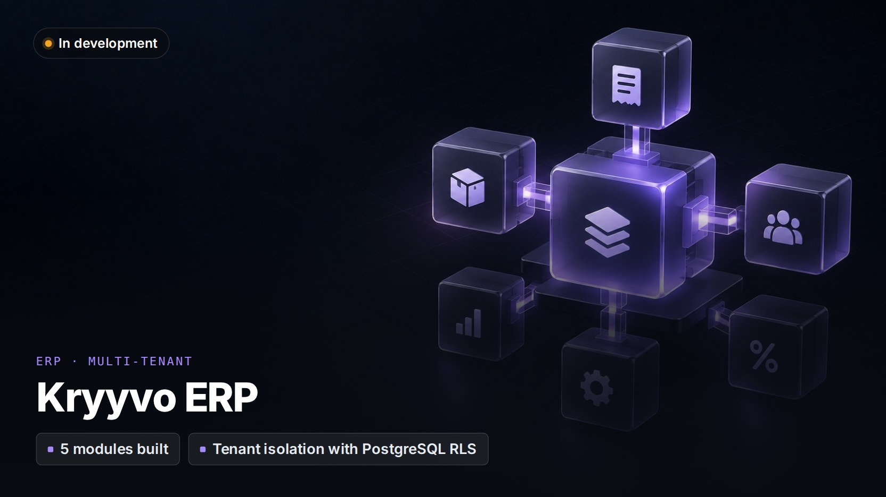
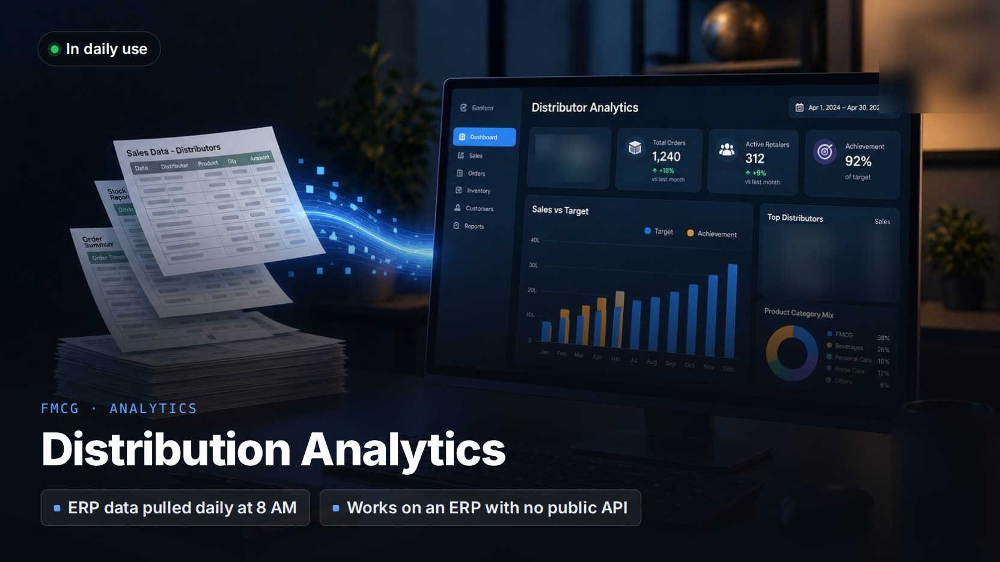
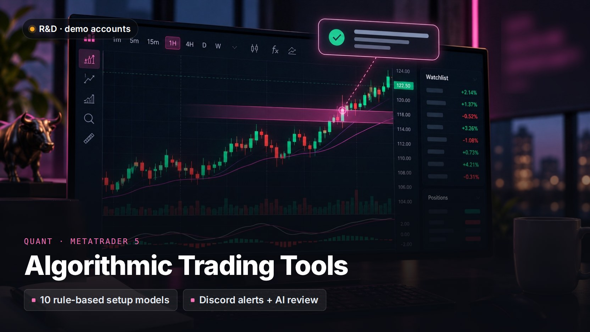

I build the software businesses run on every day: point of sale, field sales, ERP and CRM. It works offline, handles money exactly, and ships to web, desktop and mobile.

> **About the numbers below.** Every figure comes from the project's own test suite, documentation or live system. Client names are withheld and the code is private. Open any card for the details, or ask for a demo.

<table>
<tr>
<td width="50%" valign="top">

Tills and back office for a multi-campus cafeteria. 
Tauri · Rust · Vue · SQLite · Next.js · PostgreSQL
</td>
<td width="50%" valign="top">

Order booking, routes, approvals and payroll for an FMCG distributor. 
Laravel · Vue · PostgreSQL · Flutter
</td>
</tr>
<tr>
<td width="50%" valign="top">

POS, kitchen display, cafeteria register and owner dashboard. 
Electron · React · Fastify · Prisma · PostgreSQL
</td>
<td width="50%" valign="top">

Listings portal, lead CRM and ad-lead pipeline for an agency. 
Next.js · PostgreSQL · Drizzle · MongoDB · Docker
</td>
</tr>
<tr>
<td width="50%" valign="top">

A housing society's master-plan image turned into a searchable map. 
Python · OpenCV · OCR · QGIS · OpenLayers
</td>
<td width="50%" valign="top">

Scroll-driven brand site with live room booking. 
Next.js · TypeScript · GSAP · Cloudflare R2
</td>
</tr>
<tr>
<td width="50%" valign="top">

Modular, multi-tenant ERP for distributors. 
Laravel · PostgreSQL · Vue · TypeScript · Redis
</td>
<td width="50%" valign="top">

Automated management dashboards for a distributor. 
Python · Flask · pandas · ApexCharts
</td>
</tr>
<tr>
<td width="50%" valign="top">

Ask business questions in English or Roman Urdu. Every figure is verified. 
Python · LLM tool-calling · ERPNext
</td>
<td width="50%" valign="top">

Market-structure scanners with alerts and AI review. 
Python · MetaTrader 5 · pandas · discord.py
</td>
</tr>
</table>

**Stack:** Laravel · Node.js · Python · Rust · React · Next.js · Vue · Flutter · Tauri · Electron · PostgreSQL · SQLite · Redis · Docker · Linux

**Contact:** [info@kryyvo.com](mailto:info@kryyvo.com). Open to new projects.
