

  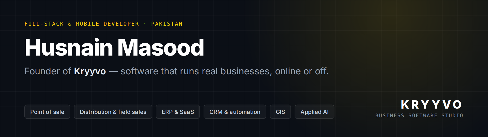

I design and build business software for companies in Pakistan: point-of-sale, distribution, ERP and CRM systems that staff use all day. Most of it has to keep working on modest hardware and patchy internet, and it has to get money exactly right. That is the work I specialise in.

Through **Kryyvo**, my software studio, I take projects from first conversation to production: architecture, backend, web and mobile apps, deployment, and support once the system is live.

- **Offline-first systems.** Tills and field apps keep working with no signal and sync safely when it returns.
- **Correct money handling.** Integer or decimal arithmetic only, never floats, and double-entry ledgers where money moves.
- **End to end.** Laravel, Node.js and Python backends; React and Vue on the web; Flutter, Tauri and Electron apps; Linux servers I deploy and run.

## Featured work

> Most of my work is private client software, so the code isn't public and client names are withheld. Each card opens a short case study. **A live demo or a code walkthrough is available on request.**

<table>
<tr>
<td width="50%" valign="top">
<a href="projects/campus-cafeteria-pos.md">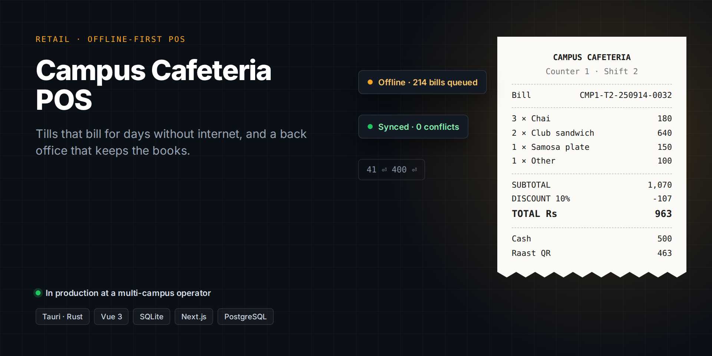</a>
<h3><a href="projects/campus-cafeteria-pos.md">Campus Cafeteria POS</a></h3>
Offline-first tills and a back office for a cafeteria operator running counters on several university campuses. Bills for days without internet, prints receipts, and keeps double-entry books.
 <b>Tauri · Rust · Vue 3 · SQLite · Next.js · PostgreSQL</b>
</td>
<td width="50%" valign="top">
<a href="projects/kryyvo-dms.md">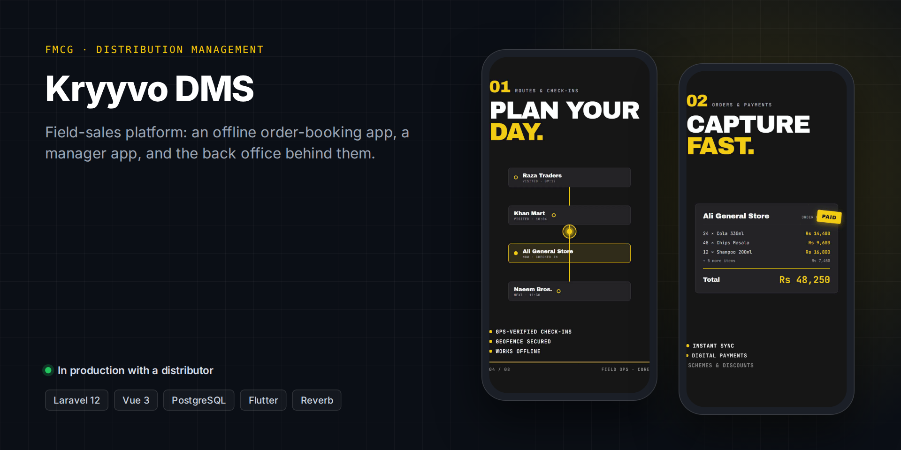</a>
<h3><a href="projects/kryyvo-dms.md">Kryyvo DMS</a></h3>
Distribution management for FMCG companies: an offline order-booking app for field reps, a manager app, and a back office covering orders, routes, approvals, HR and payroll.
 <b>Laravel 12 · Vue 3 · PostgreSQL · Flutter</b>
</td>
</tr>
<tr>
<td width="50%" valign="top">
<a href="projects/kryyvo-pos.md">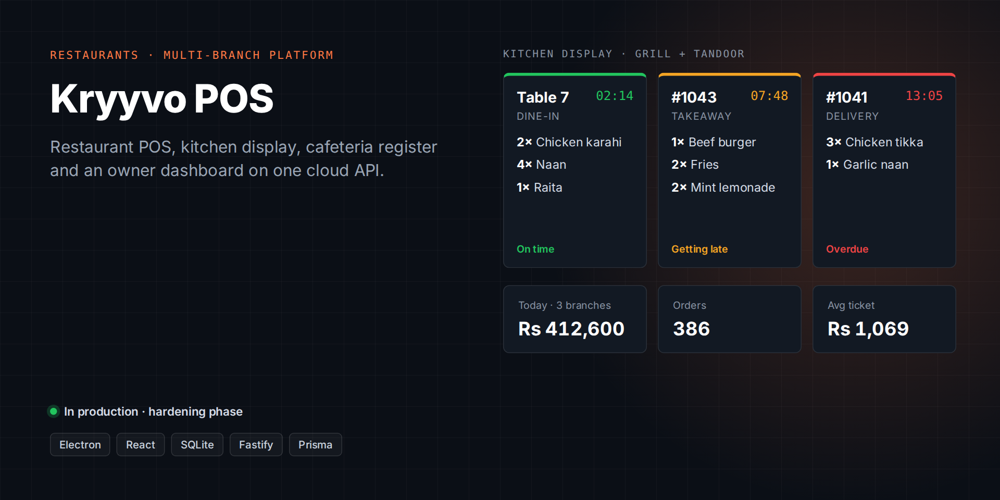</a>
<h3><a href="projects/kryyvo-pos.md">Kryyvo POS</a></h3>
A multi-business, multi-branch platform: an Electron restaurant POS, a kitchen display, a cafeteria register with customer credit, and an owner dashboard, all on one cloud API.
 <b>Electron · React · SQLite · Fastify · Prisma · PostgreSQL</b>
</td>
<td width="50%" valign="top">
<a href="projects/real-estate-sales-suite.md">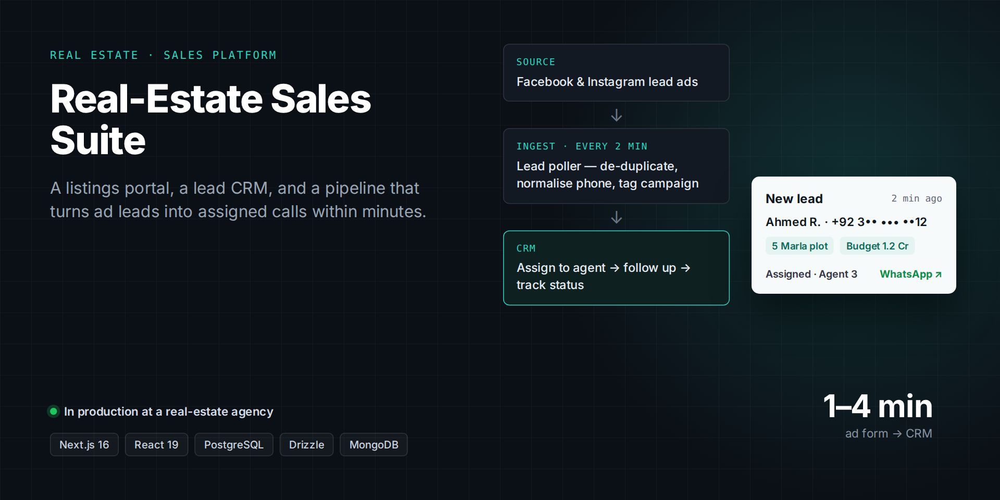</a>
<h3><a href="projects/real-estate-sales-suite.md">Real-Estate Sales Suite</a></h3>
A property listings portal with its own CMS, a lead CRM for the sales team, and a pipeline that moves Facebook and Instagram ad leads into the CRM within minutes.
 <b>Next.js · React 19 · PostgreSQL · Drizzle · MongoDB · Docker</b>
</td>
</tr>
<tr>
<td width="50%" valign="top">
<a href="projects/plot-atlas.md">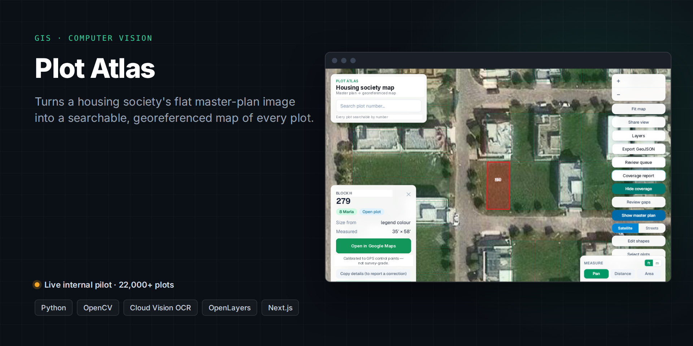</a>
<h3><a href="projects/plot-atlas.md">Plot Atlas</a></h3>
A computer-vision and GIS pipeline that turns a housing society's flat master-plan image into a searchable, georeferenced map of more than 22,000 plots.
 <b>Python · OpenCV · OCR · QGIS · OpenLayers · Next.js</b>
</td>
<td width="50%" valign="top">
<a href="projects/heritage-hotel-website.md">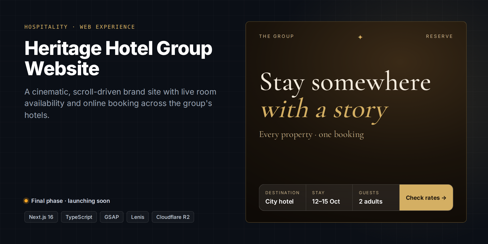</a>
<h3><a href="projects/heritage-hotel-website.md">Heritage Hotel Group Website</a></h3>
A cinematic, scroll-driven website for a multi-property hotel group, with a booking flow that reads live room availability and rates.
 <b>Next.js 16 · TypeScript · GSAP · Cloudflare R2 · Vercel</b>
</td>
</tr>
<tr>
<td width="50%" valign="top">
<a href="projects/kryyvo-erp.md">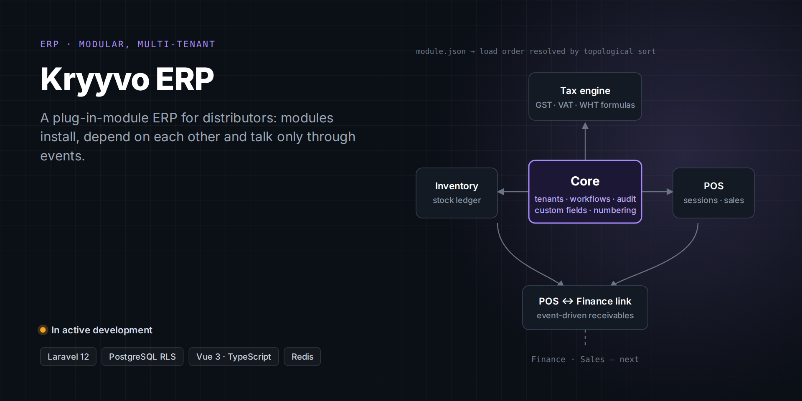</a>
<h3><a href="projects/kryyvo-erp.md">Kryyvo ERP</a></h3>
A modular, multi-tenant ERP for distributors. Modules install independently, declare their dependencies, and talk to each other only through events. In active development.
 <b>Laravel 12 · PostgreSQL · Vue 3 · TypeScript · Redis</b>
</td>
<td width="50%" valign="top">
<a href="projects/distribution-analytics.md">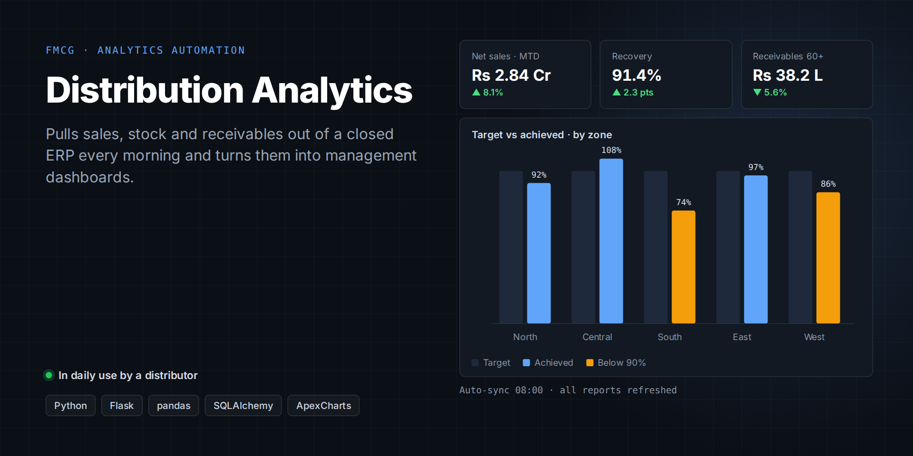</a>
<h3><a href="projects/distribution-analytics.md">Distribution Analytics</a></h3>
Every morning it pulls sales, stock and receivables out of a distributor's ERP, which has no public API, and turns them into management dashboards with targets by zone.
 <b>Python · Flask · pandas · SQLAlchemy · ApexCharts</b>
</td>
</tr>
<tr>
<td width="50%" valign="top">
<a href="projects/kryyvo-insights.md">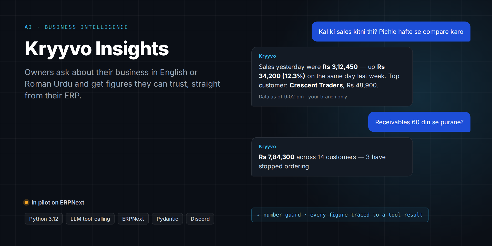</a>
<h3><a href="projects/kryyvo-insights.md">Kryyvo Insights</a></h3>
An AI assistant, now in pilot, that answers business owners' questions from their own ERP data in English or Roman Urdu. Every figure it sends has to trace back to a verified query.
 <b>Python · LLM tool-calling · ERPNext · Pydantic</b>
</td>
<td width="50%" valign="top">
<a href="projects/algorithmic-trading-tools.md">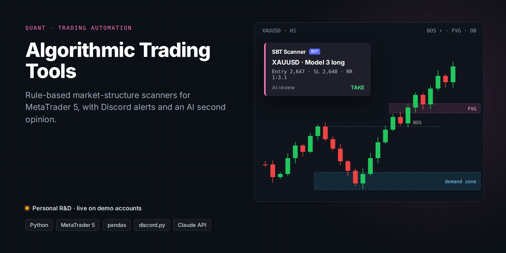</a>
<h3><a href="projects/algorithmic-trading-tools.md">Algorithmic Trading Tools</a></h3>
Rule-based market-structure scanners for MetaTrader 5 that post setups to Discord, with charts and an AI second opinion before any trade.
 <b>Python · MetaTrader 5 · pandas · discord.py</b>
</td>
</tr>
</table>

## Tech I work with

| Area | Tools |
|---|---|
| **Backend** | Laravel · PHP 8 · Node.js (Fastify, Next.js) · Python (Flask, FastAPI) · Rust |
| **Web** | React · Next.js · Vue 3 · Inertia · TypeScript · Tailwind CSS |
| **Mobile & desktop** | Flutter · Tauri · Electron |
| **Data** | PostgreSQL · SQLite · MongoDB · Redis · Prisma · Drizzle |
| **Infrastructure** | Linux VPS · Docker · Nginx · PM2 · GitHub Actions · Vercel · Cloudflare R2 |
| **AI & automation** | LLM tool-calling · OCR · OpenCV · pandas · scheduled data pipelines |

## How I work

- **Architecture decisions are written down.** Each project keeps a record of what was decided and why, so the next developer, or the client, can follow the reasoning.
- **Tests cover the parts that can cost money:** sync, ledgers, permissions and pricing. I use Pest, Vitest and pytest, and CI runs them on the larger codebases.
- **Nothing silently fails.** Failed syncs are quarantined rather than dropped, and every figure a report shows comes with how fresh it is.
- **Software ships in phases,** and each phase runs in production before the next one starts.

## Let's talk

I'm open to new projects: business systems, POS and ERP work, mobile apps, and automation.

📧 **[husnainmasood001@gmail.com](mailto:husnainmasood001@gmail.com)**
