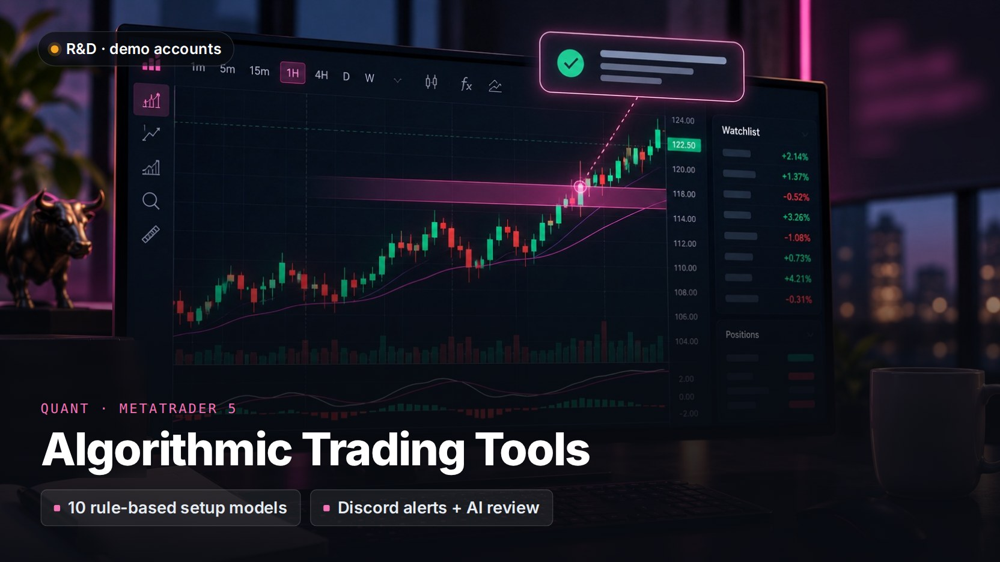

# Algorithmic Trading Tools

> **Rule-based market-structure scanners for MetaTrader 5.**
>
> Private project: the source code isn't public. A live demo or a code walkthrough is available on request.

**Client:** Personal R&D  
**My role:** Personal project: design and development  
**Status:** Running on demo accounts

## The problem

Discretionary market-structure strategies are hard to apply consistently by hand. The goal was to turn one into deterministic rules a machine can scan for, then keep a human, and an AI reviewer, in the loop.

## What I built

- **Rule engine** for swing structure, breaks of structure, fair value gaps, order blocks and supply and demand zones, across daily, 4-hour and 1-hour timeframes.
- **Always-on monitor** that polls MetaTrader 5 and posts setups with charts to Discord.
- **AI second opinion** that returns take, skip or wait before a trade.
- **Risk manager** and order placement, a walk-forward backtester, and a live dashboard.
- **Visual review tools** for checking and correcting what the engine detects.

## Engineering highlights

- A written strategy specification turned into testable, deterministic rules.
- Confluence scoring across timeframes, with news and macro context in a separate signal bot.

## Stack

| Layer | Technology |
|---|---|
| **Core** | Python, MetaTrader5, pandas, NumPy |
| **Interfaces** | Flask + WebSocket dashboard, Plotly, discord.py |
| **AI** | Claude as a trade reviewer |

---

[← Back to profile](../README.md) · Want a demo or a code walkthrough? Email [info@kryyvo.com](mailto:info@kryyvo.com).
