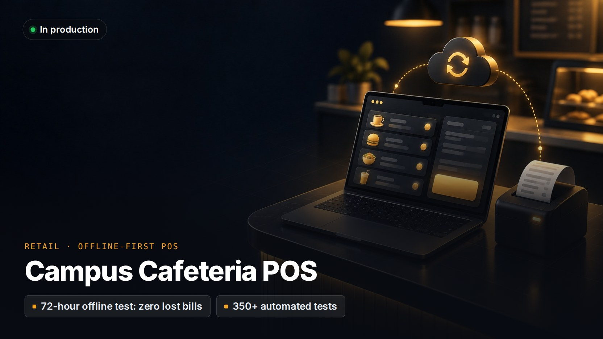

# Campus Cafeteria POS

> **Offline-first point of sale and back office for a multi-campus cafeteria operator.**
>
> Private client project: the source code isn't public and the client's name is withheld. A live demo or a code walkthrough is available on request.

**Client:** A cafeteria operator running counters inside university campuses  
**My role:** Architecture, design and full-stack development through Kryyvo  
**Status:** In production, v0.2

## The problem

The operator runs counters inside university campuses, where staff are non-technical, the laptops are cheap and the internet is unreliable. Departments order catering on credit and are billed once a month, so every rupee has to reconcile across the till, the receivable and the monthly claim document.

## What I built

- **Counter app for Windows.** Billing runs entirely from the number pad through a small command language, with English and Urdu labels and no pop-up dialogs on the billing screen.
- **Split tender** across cash, card and Raast QR at the counter. University and staff-allowance credit is recorded from a separate day book, priced on each university's agreed rates.
- **Receipts, shifts and cash control.** Thermal receipts are printed as raw printer commands. Shifts open and close with a counted float, and X and Z reports catch cash variances.
- **Offline sync.** Tills queue sales and push them to the cloud when a connection returns, and pull menu and price changes back down.
- **Back office.** Dashboard, menu and per-university price agreements, receivables, payables, costs and payroll, and an anomalies page.
- **Monthly claims for universities**, frozen once issued so a reprint months later matches the original exactly.
- **Bulk order entry.** A department's emailed requisition can be pasted in and read back line by line before billing, with duplicate-bill protection.
- **Staged auto-updates** that only install overnight and never while a bill is open.

## Engineering highlights

- Money is stored as whole paisa, never floats. The ledger is double-entry, and a test replays hundreds of orders to prove debits equal credits and match the daily totals.
- Sales are append-only: a void is a new compensating row, never an edit. That is what makes sync free of merge conflicts.
- Sync is idempotent. Replaying a batch changes nothing, and a 72-hour offline scenario with 2,000 orders is tested for zero loss and zero duplicates.
- Six architecture decision records, plus more than 350 Rust tests and Vitest suites on the cloud side.

## Stack

| Layer | Technology |
|---|---|
| **Counter app** | Tauri v2, Rust, Vue 3, SQLite |
| **Cloud & admin** | Next.js, React 19, PostgreSQL 17, Drizzle |
| **Background jobs** | Redis, BullMQ |
| **Infrastructure** | Docker Compose, Nginx, Linux VPS, Windows installers |

---

[← Back to profile](../README.md) · Want a demo or a code walkthrough? Email [info@kryyvo.com](mailto:info@kryyvo.com).
