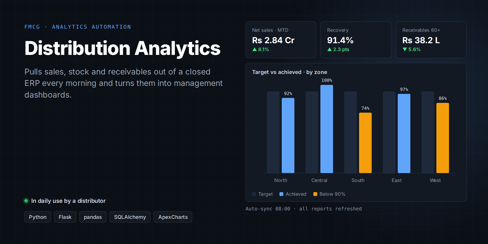

# Distribution Analytics

> **Automated management dashboards on top of an ERP with no public API.**
>
> Private client project: the source code isn't public and the client's name is withheld. A live demo or a code walkthrough is available on request.

**Client:** An FMCG distributor  
**My role:** Architecture, design and full-stack development through Kryyvo  
**Status:** In daily use

## The problem

The client's ERP holds all the numbers but offers no API and only static reports. Management was downloading spreadsheets by hand every morning to see sales, recovery and targets.

## What I built

- **Automated daily data pull** covering sales, dispatch, stock, recovery, receivables, the ledger, production and cash flow.
- **Dashboards** for overview, sales, products, customers, receivables aging, recovery, zones and targets, operations and finance.
- **Excel-driven configuration** that maps customers to zones and territory managers.
- **Roles** for admin, manager and viewer, plus sync logs and data management.

## Engineering highlights

- Integration with a system that has no public API, built by studying how its own web interface talks to the server.
- A fully unattended pipeline: scheduled download, then upsert, then refreshed dashboards before the working day starts.

## Stack

| Layer | Technology |
|---|---|
| **Backend** | Python, Flask, SQLAlchemy, Alembic, pandas |
| **Frontend** | ApexCharts, Bootstrap admin theme |
| **Infrastructure** | gunicorn, systemd, cron, Linux VPS |

---

[← Back to profile](../README.md) · Want a demo or a code walkthrough? Email [husnainmasood001@gmail.com](mailto:husnainmasood001@gmail.com).
