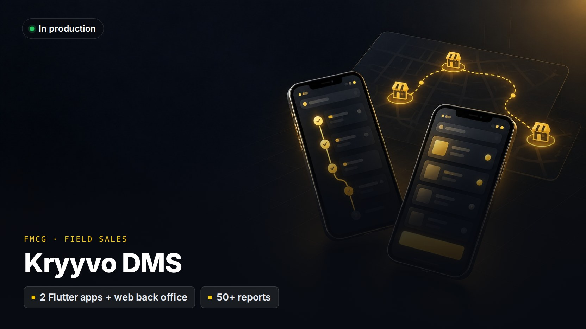

# Kryyvo DMS

> **Distribution management for FMCG companies: field sales, orders, approvals, HR and payroll.**
>
> Private client project: the source code isn't public and the client's name is withheld. A live demo or a code walkthrough is available on request.

**Client:** An FMCG distributor with a field sales force  
**My role:** Architecture, design and full-stack development through Kryyvo  
**Status:** In production

## The problem

A distributor's order bookers visit hundreds of shops a day, often with no signal. Management needs to know who actually visited which shop, what was ordered at what rate, what was collected, and whether each order was approved, and then pay the team correctly at the end of the month.

## What I built

- **Order Booker app (Flutter):** PIN and biometric login, GPS start and end of day, today's route, shop check-in, order entry and payment collection, invoice PDFs, and HR self-service. It works offline and syncs later.
- **Territory manager app (Flutter):** team attendance, a live map of the team, order review and approval, and route planning.
- **Back office (Laravel + Vue):** orders from booking to delivery with returns and credit limits, schemes and discounts, and multi-step approvals with escalation and delegation.
- **Field-force rules:** geofencing, mock-location detection, minimum time in shop and photo requirements, enforced on the device as well as the server.
- **About 50 reports** with filters, export to PDF, Excel and CSV, and scheduled email delivery.
- **HR and payroll:** leave, advances, loans, settlements, incentives and salary sheets.
- **SaaS control panel (prototype):** tenant onboarding, subscription plans, invoicing and health monitoring for running DMS as a product.

## Engineering highlights

- Offline actions carry the phone's real event time, with limits that stop someone gaming the clock.
- Idempotency keys make retries from flaky networks safe, and each user can have only one active session.
- A seven-level geography hierarchy scopes every permission and report.
- A separate, anonymised demo database with fictional data is used for sales presentations.

## Stack

| Layer | Technology |
|---|---|
| **Backend** | Laravel 12, PHP 8.2, PostgreSQL (PL/pgSQL), Sanctum, Reverb |
| **Web** | Vue 3.5, Inertia 2, Tailwind 4 |
| **Mobile** | Flutter, Provider, Dio, sqflite, background location |
| **Infrastructure** | Cloudflare R2, GitHub Actions, Pest tests |

---

[← Back to profile](../README.md) · Want a demo or a code walkthrough? Email [husnainmasood001@gmail.com](mailto:husnainmasood001@gmail.com).
