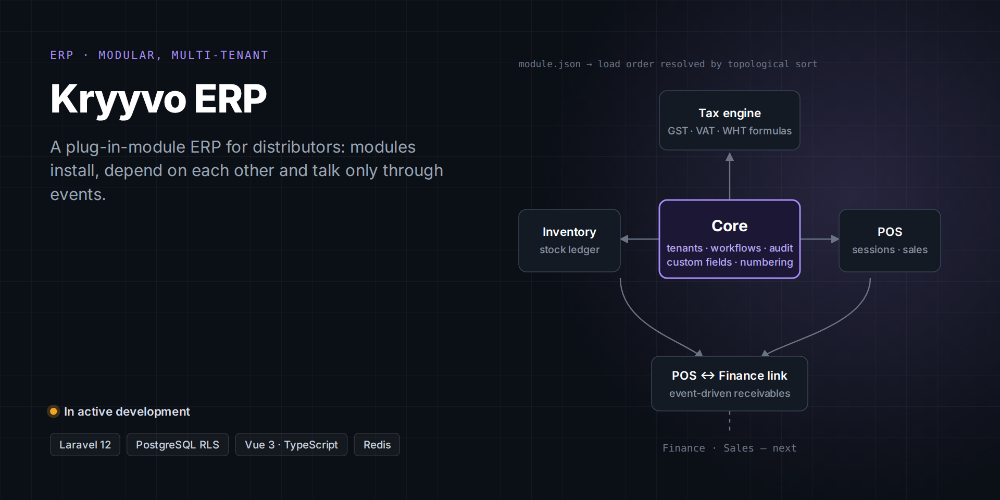

# Kryyvo ERP

> **A modular, multi-tenant ERP for distribution companies.**
>
> Kryyvo product: the source code isn't public. A live demo or a code walkthrough is available on request.

**Client:** Kryyvo product (built for FMCG distributors)  
**My role:** Architecture, design and full-stack development through Kryyvo  
**Status:** In active development

## The problem

Off-the-shelf ERPs are either too rigid or too heavy for mid-sized distributors. The aim is an ERP where each business switches on only the modules it needs, and where adding a module never means rewriting another.

## What I built

- **Core:** tenants, companies and branches, roles and permissions, a configurable workflow engine, custom fields, gap-free document numbering, and an audit log.
- **Inventory:** items, warehouses, a stock ledger, and stock adjustments with approvals.
- **POS:** terminals, sessions, sales and voids.
- **Tax engine:** formula-driven GST, VAT and withholding templates, with a tax ledger.
- **Module scaffolding:** a single command generates a new module's full structure.
- *Next:* Finance and Sales modules.

## Engineering highlights

- Modules declare their dependencies in a manifest and are loaded in dependency order. They talk only through events and interface contracts.
- Tenant isolation at two levels: application scoping plus PostgreSQL row-level security.
- Money is calculated as exact decimals, never floats.
- Custom static-analysis rules enforce the architecture, and every change goes through a plan-review and code-review pipeline with a size limit on each pull request.

## Stack

| Layer | Technology |
|---|---|
| **Backend** | Laravel 12, PHP 8.3, PostgreSQL 16, Redis, Reverb, Sanctum |
| **Frontend** | Vue 3, TypeScript, Pinia, Vuetify |
| **Quality** | Pest, Larastan, custom PHPStan rules |
| **Infrastructure** | Docker Compose, Nginx, GitHub Actions |

---

[← Back to profile](../README.md) · Want a demo or a code walkthrough? Email [husnainmasood001@gmail.com](mailto:husnainmasood001@gmail.com).
