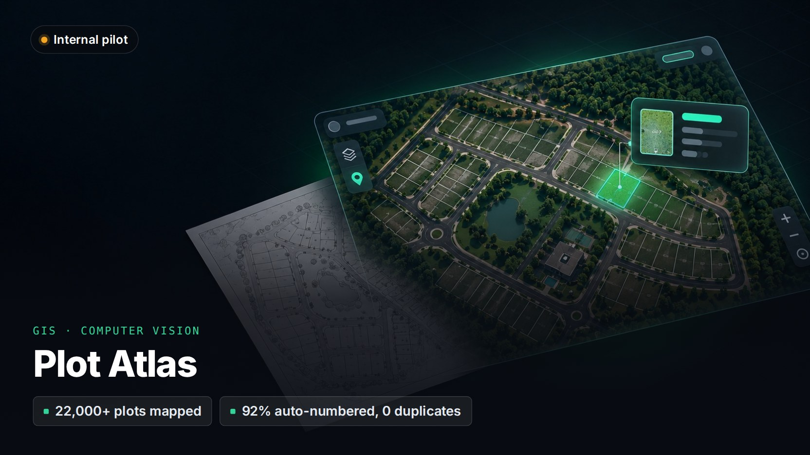

# Plot Atlas

> **A computer-vision and GIS pipeline that turns a master-plan image into a searchable map of every plot.**
>
> Private client project: the source code isn't public and the client's name is withheld. A live demo or a code walkthrough is available on request.

**Client:** A real-estate agency  
**My role:** Architecture, design and full-stack development through Kryyvo  
**Status:** Live internal pilot

## The problem

Housing-society master plans are handed around as huge flat images. Agents couldn't search them, measure them, or tell a buyer where a plot actually sits on the ground.

## What I built

- **Ten-stage processing pipeline.** It splits the image into individual plots, reads plot sizes from the legend colours, recognises plot numbers with OCR, fills gaps, and converts everything to real-world coordinates.
- **Web map.** Search any plot, see its size, dimensions and status, switch between the master plan and satellite view, and measure distance and area.
- **Review tools.** Each plot number shows how it was found (read by OCR, carried over, or inferred), and gaps can be reviewed and corrected by the team.
- **Exports** to GeoJSON, CSV, Excel and QGIS.

## Engineering highlights

- More than 22,000 plots across 70+ blocks digitised. The first finished block is 92% numbered with zero duplicate numbers.
- Outlines land within a few metres of satellite imagery. The docs say plainly that this is not survey-grade.
- Failed approaches are written up alongside the ones that worked, so decisions can be revisited.
- Over 220 automated tests on the editing and publishing side.

## Stack

| Layer | Technology |
|---|---|
| **Pipeline** | Python, NumPy, SciPy, scikit-image, OpenCV, Google Cloud Vision |
| **GIS** | QGIS, similarity transforms fitted to GPS control points |
| **Web** | Next.js 16, React 19, OpenLayers, Tailwind |
| **Infrastructure** | Linux VPS, Nginx, PM2, nightly backups |

---

[← Back to profile](../README.md) · Want a demo or a code walkthrough? Email [info@kryyvo.com](mailto:info@kryyvo.com).
