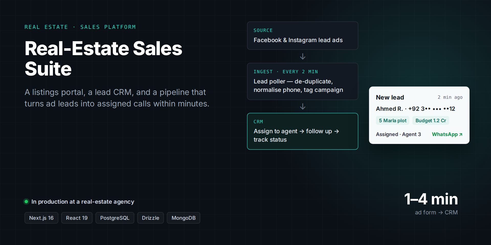

# Real-Estate Sales Suite

> **A listings portal, a lead CRM, and an automated lead pipeline for a real-estate agency.**
>
> Private client project: the source code isn't public and the client's name is withheld. A live demo or a code walkthrough is available on request.

**Client:** A real-estate agency in Pakistan  
**My role:** Architecture, design and full-stack development through Kryyvo  
**Status:** In production

## The problem

The agency runs Facebook and Instagram lead-ad campaigns and a public website. Leads were landing in spreadsheets, slipping through the cracks and getting called too late, and managers had no view of who followed up with whom.

## What I built

- **Lead pipeline.** A background service reads new lead-form submissions every two minutes, removes duplicates, normalises phone numbers and records full campaign attribution. It picks up new forms without code changes.
- **Lead CRM.** Filterable, searchable lead lists, a lead timeline with notes and follow-up dates, bulk assignment to agents, one-click WhatsApp, and a dashboard with volume, pipeline and team performance.
- **Access by role.** Admins, managers, team leads and agents each see only the leads they should.
- **Listings portal and CMS.** Property search with map view, project pages with payment plans and floor plans, a society, phase and block hierarchy, a blog, and click tracking for WhatsApp and calls per listing.

## Engineering highlights

- Leads reach an agent within one to four minutes of the form being submitted.
- No lead can be lost: the raw submission is always stored first, and duplicates are prevented at the database level.
- Access rules are enforced inside the database queries, not only hidden in the interface.
- The ingest service has about 1,900 lines of tests.

## Stack

| Layer | Technology |
|---|---|
| **CRM** | Next.js 16, React 19, TypeScript, Drizzle, PostgreSQL, NextAuth |
| **Pipeline** | Node 20, TypeScript, Google Sheets API, PostgreSQL, Vitest |
| **Portal** | Next.js, MongoDB, Leaflet, TipTap, Cloudinary |
| **Infrastructure** | Docker, Nginx, Linux VPS, Vercel |

---

[← Back to profile](../README.md) · Want a demo or a code walkthrough? Email [husnainmasood001@gmail.com](mailto:husnainmasood001@gmail.com).
